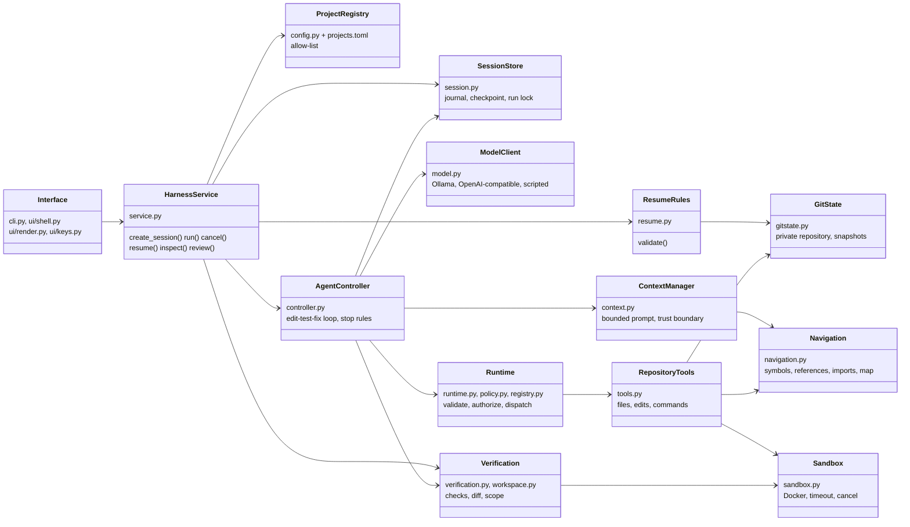
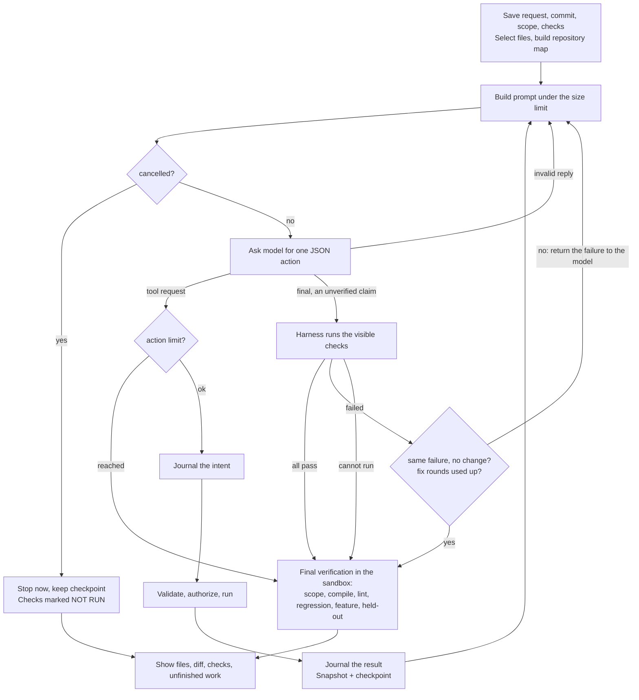
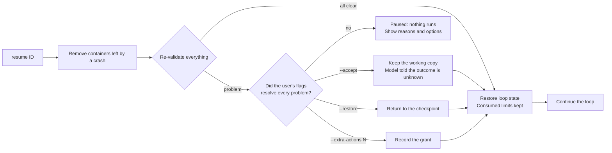

# Stage 2: a capable coding harness

A coding harness written in Python. The user selects an allowed project and
submits a feature request. The harness finds the relevant code, keeps the prompt
under a fixed size, edits a disposable copy, and uses failed checks to guide
fixes. The work is saved at every step, so a run can be cancelled, reopened and
safely resumed. At the end the harness shows the changed files, the diff, the
check results and any unfinished work, whatever the model claims.

It uses only the Python standard library and no agent framework. It extends my
[Stage 1 harness](docs/stage1/) ([plan for this stage](docs/implementation-plan.md)), whose tools, permissions, limits and bug-fix
workflow all still work.

```
● Update(src/allocation/adapters/orm.py)
  ⎿ edited from line 43
     - Column("eta", Date, nullable=True),
     + Column("eta", Date, nullable=True),
     + Column("expiry", Date, nullable=True),
● Checks, round 2 (run by the harness, in the sandbox)
  ✓ regression  PASSED 26 passed, 2 deselected
  ✓ feature     PASSED 11 passed
╭─ Result · demo-loop ─────────────────────────────────────────╮
│ ✓ VERIFIED   status completed                                │
│ used     10/40 actions · 1/3 fix rounds · 0 denied · 0 errors│
```

## Video

[Demo video](https://drive.google.com/file/d/19rwCYs-zV_6I_Crm4coHD05UWfxw_XtL/view?usp=sharing), at most 4 minutes ([script](docs/video-script.md)).

## Authors and contributions

- **Federico Magri**: individual submission. Chose the target and the feature,
  reviewed the design, the code, the diffs and the test results, ran the demo and
  recorded the video.
- **AI assistance**: an AI coding assistant was used to write most of the harness
  code, the tests and this README.
- **Reused code**: the Stage 1 harness and, through it, the controller, registry
  and permission ideas from the Week 1 lab. The target repository is
  [cosmicpython/code](https://github.com/cosmicpython/code); it is cloned, not
  included. No third-party code is part of the harness.

## Setup

Requirements: Python 3.11 or newer, Git, Docker, and Ollama for real-model runs.
There is nothing to `pip install` on the host (see `requirements.txt`).

```bash
python3 -m harness prepare               # clone the target at its commit, build the sandbox image
python3 -m unittest discover -s tests -t .   # needs no model and no key
```

Then choose a model:

```bash
# Local, no secrets (slow on CPU; see the results below)
ollama pull qwen3:8b                     # settings.example.toml is used by default

# Or any OpenAI-compatible service
cp settings.api.example.toml settings.toml
cp .env.example .env                     # then fill in the key and the base URL
python3 -m harness ping                  # one small request to check the connection
```

`.env` and `settings.toml` are ignored by Git and left out of the delivery ZIP.

## Model settings

No secrets are needed. `settings.example.toml` documents every value.

| Setting | Default | Note |
|---|---|---|
| `model.provider` | `ollama` | `openai` works with any OpenAI-compatible service |
| `model.name` | `qwen3:8b` | The suggested `qwen3.8` is about 18 GB; this machine has 14 GB of memory. The recorded runs use `Qwen/Qwen3.6-35B-A3B` through a course API. |
| `model.num_ctx` | 16384 tokens | Ollama only; must exceed `context.max_chars / 3` |
| `model.timeout_s` | 900 | Per request; CPU-only machines are slow |
| `model.api_key_env`, `model.base_url_env` | empty | Names of the variables holding the key and base URL. Sessions save the names, never the values, and the sandbox does not receive them. |

## Use it

The interactive shell is the easiest way in:

```bash
python3 -m harness
```

```
❯ /projects                    list allowed projects and tasks
❯ /new                         start the selected task with its saved request
❯ add an expiry date to ...    or type any request; the task's scope and checks apply
                               Esc or Ctrl+C cancels the active run
❯ /sessions                    list saved sessions
❯ /status ID                   progress, steps, errors
❯ /resume ID                   re-validate and continue, or pause and say why
❯ /review ID                   changed files, diff, checks, unfinished work
```

Every action is also a plain command:

```bash
python3 -m harness projects
python3 -m harness ping                           # check the model connection
python3 -m harness start                          # default project and task, real model
python3 -m harness start --script scripts/feature-script.json   # scripted replies, no model needed
python3 -m harness sessions
python3 -m harness status ID                      # --json for machine-readable output
python3 -m harness cancel ID                      # from another terminal
python3 -m harness resume ID                      # --accept | --restore | --extra-actions N | --extra-fix-rounds N
python3 -m harness review ID
python3 -m harness check ID                       # run every check again
python3 -m harness delete ID
scripts/demo.sh                                   # the whole flow with scripted replies
```

Exit codes: `0` verified, `1` not verified, `2` usage or setup error, `3` paused,
`130` cancelled.

The Stage 1 commands `prepare`, `baseline`, `run` and `verify` work as before.

## Target and feature

| | |
|---|---|
| Repository | [cosmicpython/code](https://github.com/cosmicpython/code) |
| Starting commit | `14c84797ffa77255d53cf1a02fe6aafda2b68aeb` |
| Request | [`task/feature-expiry/request.md`](task/feature-expiry/request.md): optional expiry date for stock batches. It names no file to change. |
| May change | `src/allocation/**/*.py` only |
| Modules involved | `domain/commands.py`, `domain/model.py`, `service_layer/handlers.py`, `adapters/orm.py` |
| Existing callers | `Batch(ref, sku, qty, eta)` and `CreateBatch(ref, sku, qty, eta)` keep working |
| Error case | `InvalidExpiry` when the expiry is not a date or is earlier than the eta; nothing is saved |
| Feature check | [`acceptance/feature/`](task/feature-expiry/acceptance/feature/) (11 tests): the harness returns its failures to the agent |
| Held-out check | [`acceptance/held_out/`](task/feature-expiry/acceptance/held_out/) (6 tests): run only in final verification |
| Regression check | The repository's `tests/unit` and `tests/integration` (26 tests), from a pristine copy |
| Other checks | `scope`, `compile` (build), `lint` (Ruff) |

**Starting state**: regression, lint and compile pass. The feature check has 10
of 11 tests failing, and acceptance 14 of 17, because `Batch` and `CreateBatch`
have no `expiry` and `InvalidExpiry` does not exist. The test that still passes
checks behaviour that must not change. The acceptance files are outside the
workspace, are not writable by the agent, and are mounted read-only only while a
check runs.

## Real-model results

Same request and starting commit in all runs. Full logs, journals, reports and diffs
are in [`docs/evidence-stage2/`](docs/evidence-stage2/).

| Run | Model | What happened | Verdict |
|---|---|---|---|
| `qwen-feature-1` | `qwen3:8b`, local CPU | Left out `"args"` four times; stopped at `invalid_limit`. I then made session mode accept a missing `"args"` and improved the error message. | NOT VERIFIED |
| `qwen-feature-2` | `qwen3:8b`, local CPU | 7 actions in 22 minutes, 2 to 4 minutes each. I cancelled it to change provider; no check had run. | NOT VERIFIED (cancelled) |
| `api-feature-1` | `Qwen/Qwen3.6-35B-A3B`, API | 27 actions in 72 seconds, 4 modules changed. It ran the feature check, saw 2 failures and then 4, and fixed them. | **VERIFIED**: acceptance 17/17, regression 26/26 |
| `api-feature-2` | Same | Cancelled after its first edit, with 6 actions used. I edited a file by hand: `resume` paused (`workspace_mismatch`). `resume --restore` continued from action 6 and finished at 21. | **VERIFIED**: acceptance 17/17, regression 26/26 |

**Manual help.** No help during the verified runs: no hints, no edits to the result.
The request names the new `expiry` field and `InvalidExpiry`, because the acceptance
checks import them, but no file to change. The hand edit and cancel in `api-feature-2`
were deliberate tests, undone by `--restore`.

**How the loop was verified.** In both verified runs the model ran the feature check
itself, so the harness's own fix rounds stayed at 0. A harness fix round, where a
rejected `final` returns the failures to the model, is verified with scripted replies
in `tests/test_feature.py` and `scripts/demo.sh`, not with a real model.

## Architecture



`service.py` and everything below it never print or read the keyboard. A test
enforces that core modules do not import the interface.

### The loop



**Stopping rule.** The loop ends on exactly one of these, always recorded:

| Stop | Meaning |
|---|---|
| `checks_passed` | The model finished and every visible check passed |
| `fix_limit` | Checks still fail after `limits.max_fix_rounds` rounds |
| `no_progress` | The model finished again with no change since the same failure |
| `action_limit`, `denied_limit`, `invalid_limit` | A limit was reached |
| `checks_unavailable` | A check could not run, so the result cannot be verified |
| `model_error` | The model failed after `limits.max_model_retries` retries |
| `context_limit` | Trusted instructions do not fit in the size limit |
| `workspace_mismatch` | The working copy changed outside the harness during the run |
| `cancelled` | The user cancelled |

Only final verification sets the verdict, and only `passed` on every check gives
`VERIFIED`. A failed, timed-out, unavailable or not-run check is always shown.

## Design decisions

### Navigation

`navigation.py` parses Python with `ast`. It finds classes, functions, methods and
module variables, finds references to a name, and resolves absolute and relative
imports in both directions. A file that does not parse is reported, not fatal.
Other languages appear by path, and `search_files` covers their text.

Git state comes from a **private repository outside the workspace** (`git/` in the
session). HEAD is the real starting commit, it has no remotes, and only fixed
commands run. Hooks, external diff drivers, text conversion and host Git settings
are disabled, because repository content is untrusted. The sandbox cannot see it.

### Context

Every prompt stays under `context.max_chars` (36,000 characters, about 9,000 tokens
at 4 characters per token). That is a documented estimate, not a tokenizer count.
Each prompt has this layout:

| # | Content | Trust | Can shrink? |
|---|---|---|---|
| 1 | Protocol and tool list | trusted | never |
| 2 | Task contract: request, acceptance criteria, scope, checks, commit | trusted | never |
| 3 | Repository map and up to 5 selected files | **untrusted** | yes |
| 4 | One-line summaries of older steps | **untrusted** | yes |
| 5 | Newest replies and observations, word for word | **untrusted** | yes |

**Selection.** Files are ranked by words shared between the request and their path
and symbols, with a boost for import neighbours in both directions. Words found in
most modules are ignored, and test files rank low. A small table links plain words
to code terms (for example, "database" to `orm`).

**Compaction.** Over the limit, the prompt shrinks to `target_chars`, in this order:
old turns become summaries, selected files drop (least relevant first), the map is
cut, then recent observations are shortened. Shrinking in one larger step means it
does not run every turn, which keeps Ollama's prompt cache useful on CPU. If parts 1
and 2 alone do not fit, the run stops with `context_limit` rather than lose a
constraint. Compaction decisions are saved, and the session keeps original outputs.

**Trust boundary.** Untrusted text is wrapped in `<untrusted_data>` blocks, and any
copy of that tag inside the text is neutralised, so a file cannot close the block
and pose as instructions. This reduces prompt injection but cannot rule it out, so
the real protection is that every action is still checked in code and that
verification ignores what the model says.

### Sessions and checkpoints

```
sessions/<id>/
  session.json     request, starting commit, allowed changes, checks, limits, status
  journal.jsonl    every step, flushed to disk as it happens
  checkpoint.json  last safe state: loop state + working-copy tree hash
  context.json     repository map and selected files, fixed at the start
  last_prompt.json the last prompt sent to the model
  report.json, diff.patch   latest verification
  workspace/ baseline/ git/
```

- **Write-ahead rule.** Before a tool runs, an `intent` with the updated counters is
  flushed to the journal. The checkpoint is written after the tool finishes. So any
  intent newer than the checkpoint is an action whose outcome is not certain, and a
  crash cannot refund a consumed limit.
- **Working-copy state.** A snapshot is the Git tree hash of every file, including
  ignored ones. It identifies the state, including the harness's own edits, shows
  exactly what differs, and can restore it.
- **Atomic writes.** Edits and checkpoints go through a temporary file and a rename,
  so a stop leaves the old or the new content, never a mix.
- **Crash detection.** The run lock is an OS file lock that disappears with the
  process. A session stored as `running` with a free lock is shown as `interrupted`.

### Safe resume



| Checked on every resume | If it fails | Options |
|---|---|---|
| Working copy equals the checkpoint | `workspace_mismatch` | `--accept`, `--restore` |
| Only in-scope files differ from the baseline | `scope_violation` | `--restore` only |
| No risky action was interrupted | `uncertain_action` | `--accept`, `--restore` |
| Consumed limits not exhausted | `limit_reached` | `--extra-actions`, `--extra-fix-rounds` (actions and fix rounds only) |
| Project, commit, scope and checks match the allow-list | `permissions_changed`, `project_not_allowed` | new session |
| Request, acceptance check, baseline and HEAD unchanged | `task_changed`, `acceptance_changed`, `baseline_changed`, `wrong_commit` | new session |
| Sandbox available | `sandbox_unavailable` | fix Docker, retry |

**An interrupted action is never replayed.** Edits and commands are marked uncertain
and need a decision. After either decision the model is told what happened, and any
new attempt is a new action with new checks and a new count. Interrupted reads are
marked too, but need no decision, because they change nothing. Interrupted harness
checks are not agent actions: they run again, since they only read a read-only copy.

### Cancellation

The token can be set by Esc, Ctrl+C, SIGTERM or `harness cancel ID` (a flag file
checked by the active process).

| During | What happens |
|---|---|
| Model request | The socket is shut down from the waiting thread; the server sees the connection close and stops generating |
| Command or check | `docker kill`, then the local process group is killed; a cleanup pass removes containers with the session's label |
| Before a tool | The tool does not start; the result is recorded as `cancelled` |

The sandbox mounts the workspace read-only, so a killed command cannot leave further
writes behind. A watchdog inside the container (`timeout -s KILL`) ends a command
even if the harness itself was killed. After cancelling, checks are marked `NOT RUN`.

## Safety controls

| Concern | Control, in application code |
|---|---|
| Allowed projects | Only `projects.toml` entries can be selected; each task must match the listed URL and commit |
| Disposable copy | Each session exports the pinned commit into `workspace/`, with no `.git` |
| Contained execution | `docker run --rm --network none --read-only --cap-drop ALL --security-opt no-new-privileges --pids-limit --memory --cpus --user`, read-only workspace |
| Credentials | The container gets a fixed 6-variable environment; Git gets a fixed one too; host files are not mounted |
| Push, merge, deploy | Disabled: no remote, no network, no generic shell or Git tool; commands are only `run_tests` and named checks |
| Tool arguments | Known tool, exact argument names, strings, length limits, relative paths inside the workspace, no hidden files, writable scope |
| Untrusted input | Model replies are parsed and validated; repository text and tool output stay in untrusted blocks |
| Terminal safety | Escape sequences are removed from model, repository and command text before display |
| Tests cannot be gamed | `tests/**` is protected, regression uses the pristine `tests/`, acceptance stays outside the workspace, held-out tests are never shown |
| Model claims | Shown as unverified; they cannot affect the verdict |

## Interface

The terminal interface follows current coding agents, using only the standard
library. It has a spinner with live limits and context size, one bullet per tool
call, edit previews, a line-numbered coloured diff, a result panel, slash commands
with Tab completion, and Esc to cancel. It honours `NO_COLOR`. Without a terminal it
prints plain lines, so logs stay readable.

## Tests

`python3 -m unittest discover -s tests -t .` runs all tests. Core tests use scripted
replies and need no model or API key. Tests that need Docker or the target are
skipped when those are missing.

| Required test | Where |
|---|---|
| Navigation | `tests/test_navigation.py`: symbols, references, imports, selection on the real target, Git state, no remote |
| Context | `tests/test_context.py`: limit holds as history grows, contract preserved word for word, injection stays in untrusted blocks |
| Session storage | `tests/test_sessions.py::SessionStorageTest`: task, steps, history, errors and checks reopened by a new store and service |
| Cancellation | `CancellationTest`: during a model request (real socket), during a command (child processes gone), from another process, no further writes; `test_feature.py::RealSandboxCancellationTest`: container removed. `test_ui.py::TerminalTest`: Esc on a pseudo-terminal |
| Safe resume | `ResumeTest`: harness's own edits accepted, tampering pauses, uncertain actions not replayed, limits preserved, permissions rechecked; `RealCrashTest`: `SIGKILL` during a command |
| Checks and loop | `LoopTest`: failure guides fix, claims never pass, unavailable stays visible, fix limit, no progress |
| Earlier behaviour | Stage 1 test files, unchanged: `test_tools`, `test_controller`, `test_failed_command`, `test_limits`, `test_bugfix`, `test_sandbox_docker` |
| Feature | `tests/test_feature.py`: real target + real sandbox: fails first for the expected reason, failure guides fix, all checks pass, four modules changed |
| Extra | `tests/test_ui.py`: interface separate from core, hostile text sanitised, failed checks stay visible |

## Known limits

- **Local model.** `qwen3:8b` on CPU never completed the feature here. It is too slow
  to be practical on this machine, so the verified runs need the API, and that needs
  the course VPN. Results vary between runs and models.
- **Size limit.** It counts characters, not tokens, so the token figure is an estimate.
- **Languages.** Symbols, references and dependencies are Python only.
- **Selection.** It is a word-matching heuristic and can miss a module. The agent can
  still find it with the tools.
- **Held-out tests.** The agent has no tool to read them, but they are mounted during
  the visible `feature` check, so code the agent writes could read them while that
  check runs. It could not change them, because the mount is read-only.
- **Prompt injection.** Untrusted blocks reduce it but do not remove it. A hostile file
  could still mislead the model within the allowed scope; scope checks, the sandbox and
  verification limit the damage.
- **`--accept`.** It trusts the user's decision about out-of-band changes, inside the
  writable scope only.
- **Resume location.** Sessions store absolute paths, so moving the project folder makes
  resume pause or fail. Run locks assume one machine and a local disk.
- **Containment.** Docker is a strong default, not a VM: a kernel escape would bypass it.
- **Target coverage.** Two of the target's 28 tests need Postgres or a mail server and are
  excluded. `tests/e2e` needs the docker-compose stack and is not run. The feature has
  no HTTP endpoint for expiry; it is available through `CreateBatch`.
